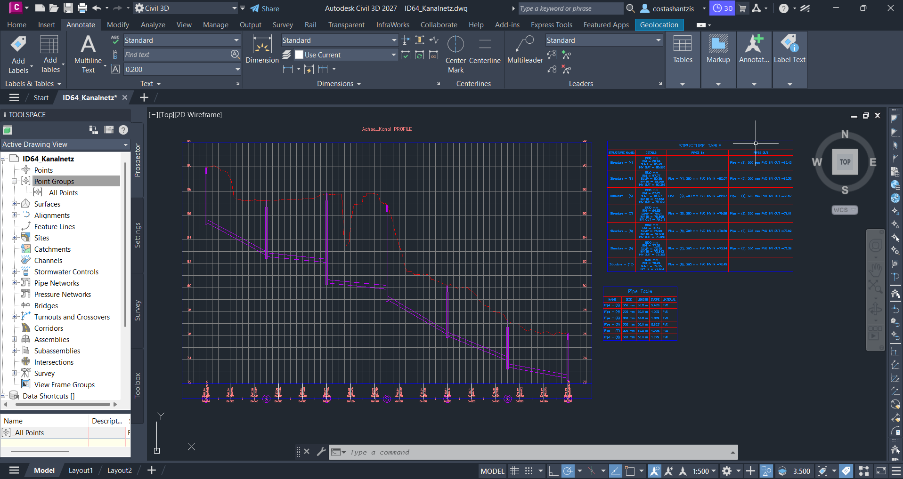
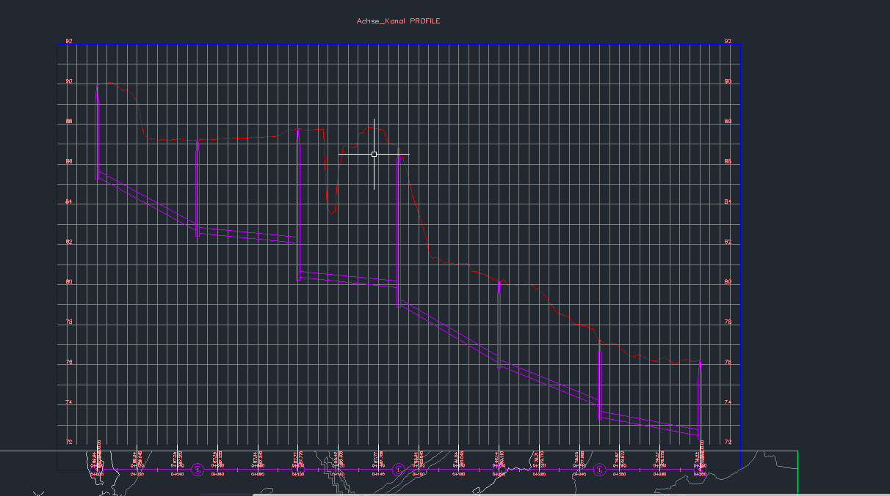
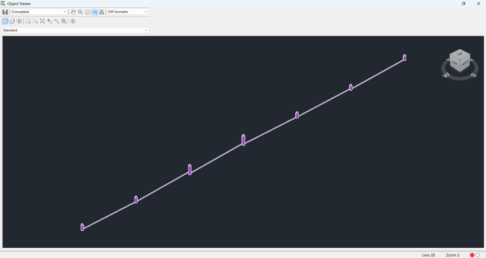
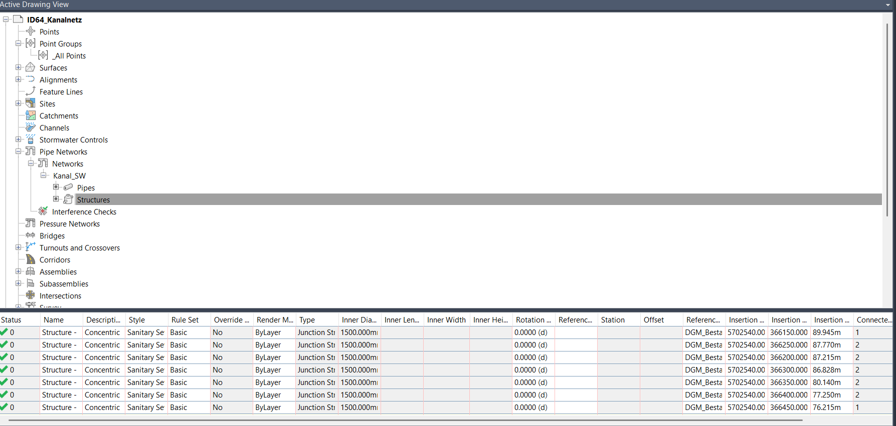
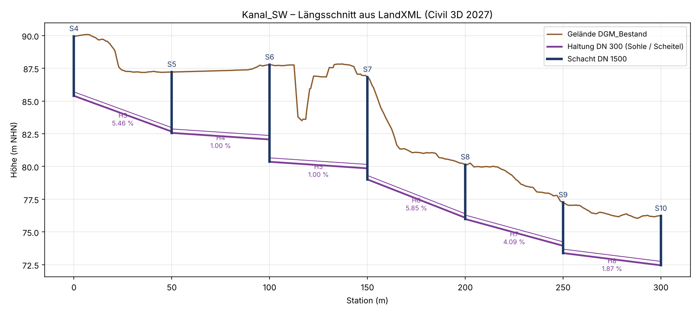
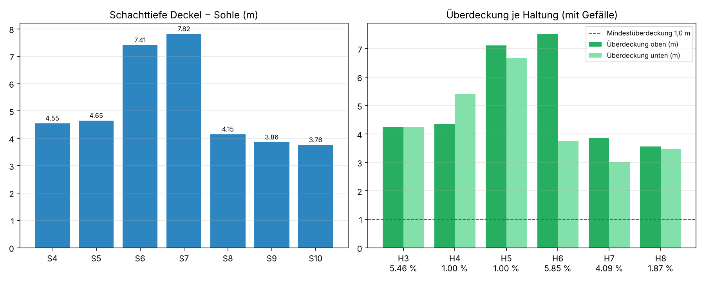

# Civil 3D – Sewer Pipe Network with Profile and Tables

[English](#civil-3d--sewer-pipe-network-with-profile-and-tables) | [Deutsch](#deutsch)

A gravity sewer in **Autodesk Civil 3D 2027** on real terrain from the **DGM1 NRW (Essen)**: **pipe network Kanal_SW** with parts list *Sanitary Sewer* and surface DGM_Bestand → **7 manholes DN 1500 and 6 pipes DN 300 PVC** (300 m, one manhole every 50 m) → **alignment from network** → **profile view** with ground line, pipes and manholes, placed exactly above the plan view → **structure and pipe tables** → **LandXML export**. The LandXML file is then checked with **Python**: manhole and pipe list, slopes, cover depth, drops in the manholes and full-flow capacity – a typical task of sewer design and documentation.



---

## Key results

| | |
|---|---|
| Terrain | DGM1 NRW (Essen), TIN surface **DGM_Bestand**, ETRS89 / UTM 32N (EPSG:25832) |
| Network | **Kanal_SW**, gravity sewer, parts list *Sanitary Sewer*, along N 5702540 from E 366150 to E 366450 |
| Parts | **7 manholes** DN 1500 (concentric), **6 pipes** DN 300 PVC, total length **300.2 m** |
| Rim elevation | **89.94 m** (S4) → **76.22 m** (S10), ground falls about 13.7 m |
| Invert | **85.40 m** (start) → **72.45 m** (end) |
| Pipe slope | **1.00 %** to **5.85 %** – all above the rule of thumb 1:DN (0.33 %) |
| Manhole depth | **3.76 m** to **7.82 m** (S7) |
| Cover depth | **3.01 m** to **7.52 m** – all above the minimum 1.0 m |
| Drop in manhole | up to **1.71 m** (S6) |
| Full-flow capacity (Manning-Strickler, kSt = 85) | **107–258 l/s**, velocity 1.5–3.7 m/s |
| Export | LandXML 1.2 (pipe network, alignment Achse_Kanal with ground profile, DGM_Bestand) |

**Interpretation:** the sewer follows the falling terrain from west to east. Civil 3D placed the pipes with the default rules (minimum cover and slope) of the parts list; because of the terrain step and the local hollow between S6 and S7 the network is deep there (manholes up to 7.8 m, drop of 1.7 m in S6). All pipes have enough slope and cover. The capacity of a DN 300 pipe (at least about 107 l/s) is large compared with the wastewater of a residential area, so the diameter could be smaller in a real design. In a real project the pipe network would be optimised (less depth, fewer drops) and checked hydraulically with real flows.



| | |
|---|---|
|  |  |





---

## Workflow in Civil 3D

| Step | Content |
|---|---|
| **1 Drawing** | Drawing with DGM_Bestand and coordinate system **ETRS89.UTM-32N**; objects of the previous projects removed |
| **2 Pipe network** | *Pipe Network Creation Tools*: name **Kanal_SW**, parts list *Sanitary Sewer*, surface DGM_Bestand; *Concentric Structure* 1500 and *300 mm PVC Pipe* |
| **3 Layout** | *Draw Pipes and Structures* with 7 absolute coordinates (every 50 m) |
| **4 Alignment and profile** | *Create Alignment from Network Parts* **Achse_Kanal** → surface profile DGM_Bestand → *Create Profile View* with the pipe network |
| **5 Position** | Profile view moved so that every manhole in the profile lies exactly above the manhole in plan (`MOVE` with point filter `.X`) |
| **6 Tables** | *Add Tables → Pipe Network → Add Structure / Add Pipe* |
| **7 Views** | *Hide Objects* (terrain hidden), *Object Viewer* (Conceptual, SW Isometric), Prospector |
| **8 Export** | *Output → Export to LandXML* |
| **9 Check in Python** | `scripts/kanal_auswertung.py` reads manholes, pipes and the ground profile and creates lists, checks and charts |

## Limitations

- The sewer is fictitious; the terrain is real
- Pipe and manhole heights from the default rules of the Civil 3D parts list, not optimised
- No real flows and no hydraulic design (e.g. DWA-A 110 / DWA-A 118) – only full-flow capacity as an estimate
- No house connections and no catchment areas
- Civil 3D was used in the 30-day trial version (non-commercial)

---

## Repository structure

```
Civil3D-Sewer-Pipe-Network/
├── data/
│   └── ID64_Kanalnetz.xml                   # LandXML export from Civil 3D
├── scripts/
│   └── kanal_auswertung.py                  # manhole/pipe list, checks, charts
├── images/
│   ├── 01_Kanalnetz_Civil3D.png
│   ├── 02_Laengsschnitt_Kanal_Civil3D.png
│   ├── 03_Kanalnetz_3D_Civil3D.png
│   ├── 04_Prospector_Structures_Civil3D.png
│   ├── 05_Laengsschnitt_LandXML.png
│   └── 06_Schaechte_Haltungen_LandXML.png
├── results/
│   ├── civil3d_kanalnetz.xlsx               # key figures, manholes, pipes
│   ├── schachtliste.csv
│   ├── haltungsliste.csv
│   └── kennzahlen.csv
├── requirements.txt
├── LICENSE
└── README.md
```

Run the check with `pip install -r requirements.txt` and `python scripts/kanal_auswertung.py`. The LandXML file can also be opened in Civil 3D, QGIS or other CAD/GIS software.

## Tools

Autodesk Civil 3D 2027 · Pipe Networks · Profile Views · Tables · LandXML · Python · pandas · NumPy · Matplotlib · Excel

## Data sources

Digital terrain model DGM1: Geobasis NRW, Datenlizenz Deutschland – Zero – Version 2.0 (dl-de/zero-2-0), tile dgm1_32_366_5702_1_nw_2025 (section 500 × 400 m, 2 m point grid). The sewer is fictitious.

## License

Code: MIT License – see [LICENSE](LICENSE)

---
---

# Deutsch

[English](#civil-3d--sewer-pipe-network-with-profile-and-tables) | [Deutsch](#deutsch)

Ein Freispiegelkanal in **Autodesk Civil 3D 2027** auf echtem Gelände aus dem **DGM1 NRW (Essen)**: **Kanalnetz Kanal_SW** mit Teileliste *Sanitary Sewer* und Fläche DGM_Bestand → **7 Schächte DN 1500 und 6 Haltungen DN 300 PVC** (300 m, alle 50 m ein Schacht) → **Achse aus dem Netz** → **Längsschnitt** mit Gelände, Haltungen und Schächten, genau über dem Lageplan → **Schacht- und Haltungstabelle** → **Export als LandXML**. Die LandXML-Datei wird anschließend mit **Python** geprüft: Schacht- und Haltungsliste, Gefälle, Überdeckung, Abstürze in den Schächten und Leistung bei Vollfüllung – eine typische Aufgabe in der Kanalplanung und Kanaldokumentation.


---

## Zentrale Ergebnisse

| | |
|---|---|
| Gelände | DGM1 NRW (Essen), TIN **DGM_Bestand**, ETRS89 / UTM 32N (EPSG:25832) |
| Netz | **Kanal_SW**, Freispiegelkanal, Teileliste *Sanitary Sewer*, entlang N 5702540 von E 366150 bis E 366450 |
| Bauteile | **7 Schächte** DN 1500 (zentrisch), **6 Haltungen** DN 300 PVC, Gesamtlänge **300,2 m** |
| Deckelhöhe | **89,94 m** (S4) → **76,22 m** (S10), Gelände fällt rund 13,7 m |
| Sohle | **85,40 m** (Anfang) → **72,45 m** (Ende) |
| Gefälle | **1,00 %** bis **5,85 %** – alle über der Faustregel 1:DN (0,33 %) |
| Schachttiefe | **3,76 m** bis **7,82 m** (S7) |
| Überdeckung | **3,01 m** bis **7,52 m** – alle über dem Minimum von 1,0 m |
| Absturz im Schacht | bis **1,71 m** (S6) |
| Leistung bei Vollfüllung (Manning-Strickler, kSt = 85) | **107–258 l/s**, Geschwindigkeit 1,5–3,7 m/s |
| Export | LandXML 1.2 (Kanalnetz, Achse Achse_Kanal mit Geländelängsschnitt, DGM_Bestand) |

**Interpretation:** Der Kanal folgt dem fallenden Gelände von West nach Ost. Civil 3D hat die Haltungen mit den Standardregeln der Teileliste (Mindestüberdeckung und Gefälle) gelegt; wegen der Geländestufe und der örtlichen Senke zwischen S6 und S7 liegt das Netz dort tief (Schächte bis 7,8 m, Absturz von 1,7 m in S6). Alle Haltungen haben genug Gefälle und Überdeckung. Die Leistung einer Haltung DN 300 (mindestens rund 107 l/s) ist groß im Vergleich zum Schmutzwasser eines Wohngebiets – in einer echten Planung könnte der Durchmesser kleiner sein. In einem echten Projekt würde man das Netz optimieren (weniger Tiefe, weniger Abstürze) und mit echten Abflüssen hydraulisch nachweisen.

---

## Arbeitsablauf in Civil 3D

| Schritt | Inhalt |
|---|---|
| **1 Zeichnung** | Zeichnung mit DGM_Bestand und Koordinatensystem **ETRS89.UTM-32N**; Objekte der vorherigen Projekte entfernt |
| **2 Kanalnetz** | *Pipe Network Creation Tools*: Name **Kanal_SW**, Teileliste *Sanitary Sewer*, Fläche DGM_Bestand; *Concentric Structure* 1500 und *300 mm PVC Pipe* |
| **3 Verlegung** | *Draw Pipes and Structures* mit 7 absoluten Koordinaten (alle 50 m) |
| **4 Achse und Längsschnitt** | *Create Alignment from Network Parts* **Achse_Kanal** → Geländelängsschnitt DGM_Bestand → *Create Profile View* mit dem Kanalnetz |
| **5 Lage** | Längsschnitt so verschoben, dass jeder Schacht im Längsschnitt genau über dem Schacht im Lageplan liegt (`MOVE` mit Punktfilter `.X`) |
| **6 Tabellen** | *Add Tables → Pipe Network → Add Structure / Add Pipe* |
| **7 Ansichten** | *Hide Objects* (Gelände ausgeblendet), *Object Viewer* (Conceptual, SW Isometric), Prospector |
| **8 Export** | *Output → Export to LandXML* |
| **9 Prüfung in Python** | `scripts/kanal_auswertung.py` liest Schächte, Haltungen und den Geländelängsschnitt und erzeugt Listen, Prüfungen und Grafiken |

## Einschränkungen

- Der Kanal ist fiktiv, das Gelände ist echt
- Höhen von Haltungen und Schächten aus den Standardregeln der Civil-3D-Teileliste, nicht optimiert
- Keine echten Abflüsse und keine hydraulische Bemessung (z. B. DWA-A 110 / DWA-A 118) – nur Vollfüllungsleistung als Abschätzung
- Keine Hausanschlüsse und keine Einzugsgebiete
- Civil 3D wurde in der 30-Tage-Testversion (nicht kommerziell) verwendet

## Werkzeuge

Autodesk Civil 3D 2027 · Pipe Networks · Profile Views · Tables · LandXML · Python · pandas · NumPy · Matplotlib · Excel

## Datenquellen

Digitales Geländemodell DGM1: Geobasis NRW, Datenlizenz Deutschland – Zero – Version 2.0 (dl-de/zero-2-0), Kachel dgm1_32_366_5702_1_nw_2025 (Ausschnitt 500 × 400 m, 2-m-Punktraster). Der Kanal ist fiktiv.

## Lizenz

Code: MIT License – siehe [LICENSE](LICENSE)
